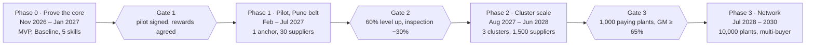

# SutraOS — Business Requirements Document (BRD) v1.0

13 Nov 2026 · Team SLB VectorSynapse · Pivot of GembaLeap

## 1. Executive summary

**SutraOS re-engineers how Indian supplier plants work, then adds small, cheap AI at the exact points where work leaks.** It is a process-transformation service delivered through software, not another ERP. We start with the plant's flow, use the Google tools it already has (WhatsApp, Drive, Sheets, a phone camera), and graduate it up a published maturity ladder that its buyers, certifiers and lenders can verify.

**Why now.** India has 9.77 crore Udyam-registered enterprises as of 6 Oct 2026, yet only 21% of surveyed MSMEs use ERP or custom business software while 65.8% already use AI tools ([CII-ISB via Business Standard](https://www.business-standard.com/economy/news/two-thirds-of-msmes-use-ai-but-only-21-deploy-business-software-study-126101301191_1.html)). The appetite for AI is there; the process underneath is not. ZED shows the same gap: about 6.67 lakh Bronze certificates but only about 6,700 Silver and 4,800 Gold as of 7 Jul 2026 ([KNN India](https://knnindia.co.in/news/newsdetails/msme/over-667-lakh-msmes-receive-zed-certification-women-owned-units-get-100percent-subsidy)). Suppliers enter the quality system; very few climb it.

**The pivot from GembaLeap.** GembaLeap proved one loop: capture evidence at the line, seal it, let the buyer verify. SutraOS keeps that loop as one module and widens the promise:

|                | GembaLeap (v2.0)                              | SutraOS (v1.0)                                                                                                  |
| -------------- | --------------------------------------------- | --------------------------------------------------------------------------------------------------------------- |
| What we sell   | A quality-evidence app for an OEM's suppliers | Process transformation + micro-AI + verifiable record, for any supplier                                         |
| Starting point | Our app and our data stack                    | The plant's existing flow and tools (WhatsApp, Drive, Sheets, Tally, SAP if present)                            |
| Unit of value  | A sealed daily report                         | A level on the Sutra Maturity Ladder (L0–L5), mapped to ZED, ISO 9001, IATF 16949                               |
| Who it serves  | 1 OEM and its Tier-2s                         | Micro to top-quality vendors, across sectors, across many buyers                                                |
| Storage        | Firestore and GCS by default                  | Tiered: Drive/Sheets for micro → Firestore/GCS for growing plants → BigQuery and ERP connectors for mature ones |
| Moat           | Sealed evidence                               | Process library + portable evidence record + subsidised distribution + field coach network                      |

**Beachhead.** Small precision-engineering suppliers (machining, sheet metal, fabrication, castings and forgings, ₹10–100 crore turnover) in the Pune–Chakan–Nashik belt, sold through 2–3 anchor buyers in auto components and industrial or energy equipment. Coimbatore and Rajkot follow in Wave 2.

**Ask.** One anchor buyer, 30 suppliers, 6 months, to prove that a supplier moves one Sutra level in 90 days and that the buyer cuts incoming inspection by 30% for suppliers at L3.

## 2. Vision, mission and positioning

**Vision.** Every Indian supplier, from a 12-person job shop to an export-grade Tier-1, runs a process its buyers can see, trust and pay for on time.

**Mission.** Lift 10,000 Indian supplier plants by at least one maturity level by 2030, using the tools they already own and AI only where it pays back in days.

**Product thesis: smart flow, small AI.** Indian suppliers do not need a sophisticated system. They need a better flow with a dozen small automations at the leak points: a photo that becomes a reading, a voice note that becomes a defect record, a mill certificate checked against spec in seconds, a daily report drafted for a human to approve. Each micro-skill is cheap, explainable and replaceable.

**Positioning statement.** For Indian manufacturing suppliers who know their work is good but cannot prove it, SutraOS is the process-transformation partner that rebuilds the shop-floor flow, adds small AI where it saves time, and turns everyday work into a verifiable record. Unlike ERPs, which digitise a broken process, and consultants, who leave a binder and walk away, SutraOS stays in the loop and makes the improvement visible to buyers, certifiers and lenders.

**Category we create:** _Supplier Capability-as-a-Service_ — consultant outcomes at software cost.

| We are                                                                         | We are not                                                            |
| ------------------------------------------------------------------------------ | --------------------------------------------------------------------- |
| A process-first transformation method, delivered by software and field coaches | An ERP, MES or QMS replacement                                        |
| A thin AI layer on WhatsApp, Google Workspace, Tally and existing ERPs         | A rip-and-replace platform needing sensors or IT staff                |
| A portable, supplier-owned capability record                                   | A public supplier ranking or a marketplace that takes a cut of orders |
| A partner to ZED, QCI, cluster bodies and anchor buyers                        | A competitor to certification bodies                                  |

**Design principles carried over from GembaLeap.** A named person approves anything another party sees. Rankings, rule checks and seals are computed in code, never in a prompt. Every AI statement links to its evidence. The supplier owns its data; sharing is scoped and revocable. No public ranking.

## 3. The market problem: why Indian suppliers stay invisible

**The core problem is not missing software; it is a process that produces no usable evidence.** Work happens, quality is often fine, but the proof lives on paper travellers, in WhatsApp photos and in the supervisor's head. Buyers compensate with 100% incoming inspection, repeated audits and long payment terms.

**Seven deep-rooted problems**

| #   | Problem                                                   | What it looks like on the floor                                                 | Evidence                                                                                                                                                                                                          |
| --- | --------------------------------------------------------- | ------------------------------------------------------------------------------- | ----------------------------------------------------------------------------------------------------------------------------------------------------------------------------------------------------------------- |
| 1   | Process lives in people, not systems                      | Check sheets filled at shift end from memory; one senior person "knows" the job | 65–70% of manufacturing MSMEs are estimated to run production on paper or Excel (industry estimate, unverified)                                                                                                   |
| 2   | Tools adopted, process not changed                        | AI used for messages and content, not operations                                | 65.8% use AI tools, 21% use ERP or custom software (CII-ISB)                                                                                                                                                      |
| 3   | Certification stops at the entry level                    | Bronze certificate on the wall, no change in daily practice                     | ~6.67 lakh Bronze vs ~11,500 Silver + Gold (KNN India)                                                                                                                                                            |
| 4   | Buyers do not ask for proof, so suppliers do not build it | No customer pull for certification                                              | Only 32% hold a recognised certification; 50.9% of the rest say customers did not require it (CII-ISB)                                                                                                            |
| 5   | Trust is inherited, not earned                            | New vendors locked out; incumbents audited again and again                      | Qualitative; confirmed in GembaLeap interviews                                                                                                                                                                    |
| 6   | Cash is late because quality is disputed                  | Rejections argued on email; invoices held                                       | Recordent reports average 73 days to clear invoices vs the 45-day legal mandate ([Fintech BizNews](https://fintechbiznews.com/fintech-information-technology/risk-to-receivables-how-indian-smes-are-struggling)) |
| 7   | Government support is under-used                          | Schemes known, not claimed                                                      | 74.9% know a scheme, 42.6% used one (CII-ISB)                                                                                                                                                                     |

**How the rest of the world is moving — with small steps, not big systems**

| Region        | What changed                                                                                                                                                                                                                                                                                                                                                                                                                              | Lesson for India                                                                                                         |
| ------------- | ----------------------------------------------------------------------------------------------------------------------------------------------------------------------------------------------------------------------------------------------------------------------------------------------------------------------------------------------------------------------------------------------------------------------------------------- | ------------------------------------------------------------------------------------------------------------------------ |
| Germany       | Catena-X data space reached 1,069 active participants by Sep 2026 ([Automotive Logistics](https://www.automotivelogistics.media/supply-chain/more-thannbsp1000-oems-and-suppliers-now-exchanging-data-through-catena-x-network/2746686)); a €23 million accelerator pays SMEs to onboard ([Catena-X](https://catena-x.net/news/e23-million-data-space-accelerator-launched-to-fast-track-sme-integration-within-the-catena-x-ecosystem/)) | Even Germany has to subsidise SME onboarding because connectors are heavy. India needs a phone-first, pre-connector path |
| Japan         | OEM-led supplier development: buyers send people to fix suppliers' flow (kaizen) before asking for data                                                                                                                                                                                                                                                                                                                                   | Process first, data second. Anchor buyers must co-invest                                                                 |
| United States | A public extension network (NIST MEP) gives small manufacturers hands-on lean and quality help                                                                                                                                                                                                                                                                                                                                            | A field-coach layer is what makes adoption stick                                                                         |

**Root cause.** Capturing evidence costs the operator more than it gives back, and nothing converts that evidence into something a buyer, certifier or lender values. SutraOS fixes both sides: make capture faster than skipping it, and make the record pay.

## 4. Market sizing, segmentation and maturity baseline

**We size the market from quality-aware manufacturers, not all MSMEs: about 9.49 lakh units have already registered for ZED**, so they have shown intent to improve. MSMEs produce about 35.4% of India's manufacturing output and 48.58% of exports ([PIB via NewKerala](https://www.newkerala.com/news/a/parliamentary-panel-reviews-support-msmes-chairperson-tiruchi-siva-720.htm)).

| Layer    | Definition                                                                                 | Units      | ₹ per unit per year  | Annual value    |
| -------- | ------------------------------------------------------------------------------------------ | ---------- | -------------------- | --------------- |
| TAM      | Manufacturing units registered under ZED                                                   | ~9.49 lakh | ₹36,000 (entry tier) | ~₹3,400 crore   |
| SAM      | Small and medium engineering suppliers selling to organised buyers (assumption: ~1.5 lakh) | ~1.5 lakh  | ₹1.2 lakh (blended)  | ~₹1,800 crore   |
| SOM 2030 | Plants on SutraOS                                                                          | 10,000     | ₹1.2 lakh            | ~₹120 crore ARR |

SAM and SOM are planning assumptions to be validated in the pilot. Services, embedded-finance referrals and buyer fees are upside on top.

### Sutra Maturity Ladder (the baseline definition)

Every plant gets a level from a one-day **Sutra Baseline**: a 25-question self-assessment, a guided gemba walk recorded on a phone, and a review of 2 weeks of existing records. Five dimensions are scored 0–5: standard work, inspection and evidence, problem solving, delivery and flow, data and connectivity. The plant's level is the lowest dimension that has evidence, so no level is claimed without proof.

| Level | Name       | What is true                                                            | External equivalent       | Estimated share of target plants |
| ----- | ---------- | ----------------------------------------------------------------------- | ------------------------- | -------------------------------- |
| L0    | Invisible  | Paper or memory; quality depends on individuals                         | None                      | ~55%                             |
| L1    | Recorded   | Checks captured digitally with photos; WhatsApp or Sheets               | ZED Bronze                | ~25%                             |
| L2    | Controlled | Limits computed, out-of-limit forces containment, daily report          | ISO 9001 in practice      | ~12%                             |
| L3    | Proven     | 90-day evidence streak verified by a buyer; reduced inspection eligible | ZED Silver                | ~6%                              |
| L4    | Improving  | Closed-loop CAPA/8D, SPC, cost-of-quality tracked                       | ZED Gold, IATF 16949      | ~1.5%                            |
| L5    | Connected  | System-to-system data exchange with buyers, lenders, certifiers         | Catena-X-style data space | <0.5%                            |

Shares are working estimates triangulated from three facts: 21% of MSMEs use ERP, 32% hold a certification, and Silver plus Gold are about 1.2% of ZED registrations. The pilot replaces them with measured baselines.

### Segments by sector

| Segment                                                       | Typical buyer pressure                  | Typical level today | Digital readiness | Buyer pays?                        | Fit        |
| ------------------------------------------------------------- | --------------------------------------- | ------------------- | ----------------- | ---------------------------------- | ---------- |
| Auto components Tier-2/3 (machining, pressings, plastics)     | High: PPAP, IATF, PPM targets           | L1–L2               | Medium            | Yes (supplier development budgets) | **Wave 1** |
| Industrial and energy fabrication, castings, forgings, valves | High: MTC, hydro test, traceability     | L0–L2               | Low–medium        | Yes (inspection cost is high)      | **Wave 1** |
| Electronics and EMS sub-suppliers                             | Rising: ECMS localisation, traceability | L1–L2               | Medium–high       | Partly                             | Wave 2     |
| Defence and aerospace sub-tier                                | Very high: AS9100, first-article        | L2–L3               | Medium            | Yes                                | Wave 2     |
| Pharma packaging and components                               | High: GMP, audit trail                  | L2                  | Medium            | Yes                                | Wave 3     |
| Textile and apparel exporters                                 | Brand compliance audits                 | L1–L2               | Medium            | Brands sometimes                   | Wave 3     |
| Food processing                                               | FSSAI, export residue tests             | L0–L1               | Low               | Rarely                             | Later      |

**Size bands within each segment.** Micro (≤ ₹10 crore turnover) start on the WhatsApp + Drive kit; small (₹10–100 crore) get the full SutraOS app; medium (₹100–500 crore) add ERP connectors and BigQuery. Thresholds follow the revised MSME classification.

## 5. Beachhead and segment-wise go-to-market

**First cut: small precision-engineering suppliers (L0–L2, ₹10–100 crore turnover) serving auto-component and industrial/energy OEMs in the Pune–Chakan–Nashik belt.** They feel quality pressure daily, their buyers already spend on inspection and supplier development, and they are dense enough for one coach to serve 15 plants within a 60 km radius. Auto components alone turned over ₹7.6 lakh crore in FY26 and target $200 billion by 2030 ([AutocarPro](https://www.autocarpro.in/NEWS/acma-convenes-66th-annual-session-134480)), while China's share of India's component imports rose to 36% ([Kotak Neo](https://www.kotakneo.com/news/sectors/china-share-india-auto-component-imports-fy26-acma/)): localisation needs suppliers who can prove quality.

**Why this segment wins the first cut**

| Criterion                | Score (1–5) | Reason                                                                              |
| ------------------------ | ----------- | ----------------------------------------------------------------------------------- |
| Pain intensity           | 5           | Rejections, PPAP, MTC disputes, 100% inspection                                     |
| Buyer willingness to pay | 5           | Inspection hours and escapes cost the buyer more than ₹40–60k per supplier per year |
| Reachability             | 4           | Clusters, ACMA and CII chapters, OEM supplier meets                                 |
| Readiness                | 3           | Smartphones and WhatsApp universal; ERP patchy                                      |
| Proof speed              | 5           | Rejection PPM and inspection hours move within 90 days                              |
| Expansion path           | 5           | Same flows apply to castings, forgings, fabrication and electronics                 |

### Plan by maturity level

| Starting level              | Offer                                                                        | Channel                                                      | First 90 days                                               | Graduation target                  |
| --------------------------- | ---------------------------------------------------------------------------- | ------------------------------------------------------------ | ----------------------------------------------------------- | ---------------------------------- |
| L0 Invisible (micro, paper) | **Sutra Start** — WhatsApp bot + Google Forms/Sheets + Drive kit, vernacular | Cluster associations, ZED facilitation, anchor buyer invites | Digital check capture for 3 critical stages; photo evidence | L1 in 30 days                      |
| L1 Recorded                 | **Sutra Grow** — SutraOS app, daily checklist, containment, AI daily report  | Anchor buyer programme                                       | Process map, 5 micro-AI skills switched on, daily reports   | L2 in 60–90 days, ZED Bronze       |
| L2 Controlled               | **Sutra Prove** — sealed reports, buyer verification, payment clock, CAPA/8D | Anchor buyer + bank/TReDS partners                           | 90-day evidence streak                                      | L3, reduced inspection, ZED Silver |
| L3–L4 Proven/Improving      | **Sutra Pro** — SPC, cost of quality, ERP connectors, sourcing profile       | Direct sales, buyer network                                  | Connect ERP/Tally; multi-buyer sharing                      | L4, ZED Gold / IATF readiness      |
| L5 Connected                | **Sutra Connect** — API and data-space bridge                                | Partnerships                                                 | Exchange data with global OEM portals                       | Export readiness                   |

### Rollout waves

1. **Wave 1 (months 0–9):** Pune–Chakan–Nashik. 1–3 anchor buyers, 30 → 150 suppliers. Auto components and industrial/energy fabrication.
2. **Wave 2 (months 9–24):** Coimbatore (pumps, foundries), Rajkot (castings, machine parts), Chennai and Noida electronics sub-suppliers. 1,500 suppliers.
3. **Wave 3 (months 24–48):** Bengaluru–Hyderabad defence and aerospace sub-tier, pharma packaging, textile exporters. 10,000 suppliers.

**GTM motion: B2B2B.** The anchor buyer invites and funds its suppliers (land), suppliers reuse the record with other buyers (expand), and buyers join to reach better suppliers (network). Cluster bodies and ZED facilitation centres are the second channel for suppliers without an anchor.

## 6. Business objectives and KPIs

**North star: supplier-levels gained per quarter** (sum of verified level-ups across all plants). It moves only when a plant genuinely improves and a buyer can see it.

| Objective                   | KPI                                                 | Pilot target (6 months) | 2028 target             |
| --------------------------- | --------------------------------------------------- | ----------------------- | ----------------------- |
| Lift supplier maturity      | Plants gaining ≥ 1 Sutra level in 90 days           | ≥ 60%                   | ≥ 70%                   |
| Make capture a habit        | Scheduled checks recorded with evidence             | ≥ 95%                   | ≥ 97%                   |
| Cut waste for the buyer     | Incoming inspection hours per lot for L3 suppliers  | −30%                    | −50%                    |
| Cut escapes                 | Customer rejection PPM                              | −25% vs baseline        | −50%                    |
| Speed up cash               | Days sales outstanding for participating suppliers  | −10 days                | −20 days                |
| Unlock schemes              | ZED level-ups (Bronze → Silver → Gold) supported    | 10                      | 1,000                   |
| Open the market             | New vendors qualified by buyers from Sutra profiles | ≥ 1 per anchor          | ≥ 5 per anchor per year |
| Grow the business           | Paying plants / ARR                                 | 30 / ₹36 lakh           | 3,000 / ₹36 crore       |
| Keep unit economics healthy | Gross margin; logo retention                        | ≥ 55%; ≥ 90%            | ≥ 70%; ≥ 92%            |

**Guardrails.** 100% of out-of-limit readings have containment recorded. 0 AI statements published without a cited evidence item. 0 supplier data shared without live consent.

## 7. Stakeholders and value proposition

**Each stakeholder gets something it can count; that is why the record gets used.**

| Stakeholder               | Persona                            | Today                                     | With SutraOS                                                                   | What they pay or give                  |
| ------------------------- | ---------------------------------- | ----------------------------------------- | ------------------------------------------------------------------------------ | -------------------------------------- |
| Line operator / line lead | Lan, Ravi (Marathi/Hindi speakers) | Paper check sheets at shift end           | 20-second check by photo or voice in own language                              | Time; nothing to learn beyond WhatsApp |
| Supplier owner            | Haruka / Suresh, 45-person plant   | Knows the line runs well, cannot prove it | Level on the ladder, sealed reports, faster payment, new buyers                | ₹3k–15k per month, or funded by anchor |
| Supplier quality engineer | Meena                              | 8Ds in Word, audits by binder             | AI-drafted CAPA with evidence, audit pack in one click                         | —                                      |
| Buyer SQE                 | Arjun, 140 suppliers               | 100% inspection, snapshot audits          | Watch-list of drifting suppliers, verify seals, reduced inspection by evidence | Supplier development budget            |
| Buyer procurement         | Kaori / Priya                      | Few vendors, price talks on email         | Evidence-based vendor pool; documented fair dealing, payment-term compliance   | Sourcing module fee                    |
| Field coach               | Sutra Coach (diploma engineer)     | —                                         | Runs baselines, maps flows, coaches 15 plants                                  | Salaried or partner                    |
| Lender / TReDS platform   | Bank, NBFC                         | Collateral-based credit                   | Verified operating record for cash-flow lending                                | Referral fee                           |
| Certifier / scheme body   | ZED, QCI, ISO bodies               | Paper audits                              | Pre-audit evidence pack; continuous proof                                      | Partnership                            |
| Cluster association       | Local industry body                | Training events                           | Measurable cluster upgrade                                                     | Channel                                |

**Selling points beyond quality:** lighter inspection, faster CAPA closure, on-time payment visibility (45-day rule), scheme access, export readiness and new customers.

## 8. Business model, pricing and unit economics

**Buyers fund the first year; suppliers keep paying because the record earns them money.**

| Stream                                       | Who pays                                       | Price (hypothesis, excl. GST)                                               | Starts  |
| -------------------------------------------- | ---------------------------------------------- | --------------------------------------------------------------------------- | ------- |
| Anchor buyer programme                       | OEM / Tier-1                                   | ₹3,500 per supplier per month (~USD 40), incl. buyer seats and verification | Pilot   |
| Transformation sprint                        | Supplier (often offset by scheme support)      | ₹1.5 lakh one-time: baseline, process redesign, 90-day coaching             | Pilot   |
| Supplier subscription                        | Supplier                                       | Start ₹999 · Grow ₹4,999 · Prove ₹9,999 · Pro ₹24,999 per month             | Month 6 |
| Sourcing and network                         | Buyer procurement                              | ₹5 lakh per buyer per year for the evidence-based vendor pool               | Year 2  |
| Embedded finance and certification referrals | TReDS platforms, NBFCs, certification partners | Referral fee per financed invoice or completed certification                | Year 2  |

**Scheme leverage.** ZED offers handholding support of up to ₹2 lakh for consultancy and up to ₹3 lakh for technology upgradation to certified MSMEs ([scheme summary](https://www.publicservicesmap.in/schemes/msme-sustainable-zed-certification-scheme--mszcs?lang=en)). If SutraOS is empanelled where rules allow, the sprint costs many suppliers little or nothing. Eligibility must be confirmed with the ZED implementing agency before we promise it.

**Unit economics per supplier (estimates)**

| Line                           | Year 1 (in transformation)                                               | Steady state                    |
| ------------------------------ | ------------------------------------------------------------------------ | ------------------------------- |
| Revenue per supplier per month | ₹3,500 (buyer) + ₹12,500 (sprint spread over 12 months) = ₹16,000        | ₹8,000–10,000 blended           |
| Cloud + AI cost per month      | ₹450–1,300 (from the GembaLeap estimate of USD 150–450 per 30 suppliers) | ₹300–900 (Drive tier for micro) |
| Coach cost per month           | ₹4,500 (1 coach : 15 plants in sprint)                                   | ₹1,700 (1 : 40 in steady state) |
| Gross margin                   | ~60%                                                                     | ~70–75%                         |
| CAC via anchor buyer           | ~₹15,000                                                                 | ~₹8,000 via network referrals   |
| Payback                        | < 3 months                                                               | < 2 months                      |

**Smart cost design.** Storage follows the plant's complexity: micro plants keep evidence in their own Google Drive and Sheets (near-zero marginal cost and true data ownership); growing plants move to Firestore and Cloud Storage; mature plants add BigQuery and ERP connectors. AI calls default to the cheapest Gemini Flash-Lite tier and escalate only when a rule says the task needs it.

## 9. Moat and competitive landscape

**Our moat is not the AI; models are a commodity. It is five assets that compound with every plant we transform.**

1. **Sutra Process Library.** Re-imagined flows, check templates and micro-AI recipes per sub-sector (press shop, CNC, weld fabrication, foundry, PCB assembly), each mapped to ZED, ISO 9001 and IATF clauses. Plant 100 is 5× faster to transform than plant 1.
2. **Portable evidence record.** A supplier-owned, sealed, time-stamped history of how it actually runs. It is reusable across buyers, so every new buyer adds value for every supplier and vice versa (two-sided network effect).
3. **Subsidised, trusted distribution.** Anchor buyers fund onboarding; cluster bodies and scheme facilitation lower acquisition cost to near zero.
4. **Field coach network.** Vernacular, cluster-based coaches who change the flow on the floor. Software competitors lack this; consultants cannot scale it at our cost.
5. **Outcome data.** Which interventions moved which plants up a level, at what cost.

| Alternative                                                   | What they do well                | Where they fall short for this segment                                   | Our stance                             |
| ------------------------------------------------------------- | -------------------------------- | ------------------------------------------------------------------------ | -------------------------------------- |
| ERPs for small business (Tally, Zoho, Odoo, SAP Business One) | Accounting, inventory, invoicing | Digitise the existing process; little shop-floor evidence or buyer trust | Integrate, never replace               |
| Enterprise supplier portals and QMS (SAP Ariba, OEM portals)  | Buyer-side workflows             | Built for the buyer; suppliers re-type data into each portal             | Feed them from one record              |
| Manufacturing marketplaces                                    | Demand aggregation               | Take a margin on orders; capability data stays theirs                    | Supplier owns the record; no take rate |
| Lean and quality consultants, ZED facilitators                | Expertise, trust                 | Episodic; improvement fades after the audit                              | Partner and equip them with SutraOS    |
| Spreadsheets + WhatsApp (status quo)                          | Free, familiar                   | No limits, no seal, no trend, no buyer view                              | Start here and upgrade in place        |

**Defensible position:** the only player that combines the consultant's process change, the software's scale and a record that belongs to the supplier.

## 10. Business requirements

| ID    | Requirement                                                                      | Priority | Measure of done                                                          |
| ----- | -------------------------------------------------------------------------------- | -------- | ------------------------------------------------------------------------ |
| BR-01 | Baseline any supplier plant in one day and assign a Sutra level with evidence    | Must     | Baseline report in < 24 h; second assessor agrees within 1 level         |
| BR-02 | Redesign the plant's flow and mark where waste and missing evidence occur        | Must     | Current- and future-state map per plant, ≥ 5 marked leak points          |
| BR-03 | Run on tools the supplier already has; no hardware or sensors required           | Must     | 100% of L0–L1 plants onboard with phone + WhatsApp + Google account only |
| BR-04 | Offer micro-AI skills that each save measurable time or catch a measurable error | Must     | Each skill has a metric and an eval pass bar                             |
| BR-05 | Keep data owned by the supplier, stored in the tier that fits its scale          | Must     | Full export; Drive tier keeps files in supplier's own account            |
| BR-06 | Let buyers verify evidence and reports independently                             | Must     | Seal recomputed client-side; audit chain verifiable                      |
| BR-07 | Link maturity to concrete rewards (inspection tier, payment, new buyers)         | Must     | Reward rules agreed in writing with each anchor buyer                    |
| BR-08 | Work in at least 6 Indian languages and offline                                  | Must     | Marathi, Hindi, Tamil, Gujarati, Kannada, English; offline queue         |
| BR-09 | Map evidence to ZED, ISO 9001 and IATF 16949 clauses for audit packs             | Should   | One-click audit pack per standard                                        |
| BR-10 | Track invoices against the 45-day MSMED rule and connect to TReDS partners       | Should   | Payment clock visible to both sides; referral flow live                  |
| BR-11 | Integrate with Tally, Zoho and SAP where present                                 | Should   | Read-only connectors for POs, invoices and item masters                  |
| BR-12 | Provide cluster and programme dashboards                                         | Could    | Aggregates only, ≥ 5 plants per cell, no individual ranking              |

## 11. Risks, assumptions and constraints

**The biggest risk is behavioural, not technical: operators and owners must keep recording once the coach leaves.**

| Risk                                    | Likelihood | Impact | Mitigation                                                                 |
| --------------------------------------- | ---------- | ------ | -------------------------------------------------------------------------- |
| Recording fades after month 2           | High       | High   | Capture under 20 s; weekly reward visibility; streaks and WhatsApp nudges  |
| Anchor buyer will not commit rewards    | Medium     | High   | Reward rules signed before pilot; start with one measurable reward         |
| Suppliers fear sharing data with buyers | Medium     | High   | Supplier-owned storage, scoped and revocable consent, access log           |
| Evidence gaming (staged photos)         | Medium     | Medium | Random sampling, metadata checks, buyer spot audits, anomaly rules in code |
| AI error in a reading or report         | Medium     | Medium | Human approval on every shared item; citations required; evals             |
| Coach model does not scale              | Medium     | High   | Process library and AI-guided baseline cut coach time 50% by year 2        |
| Scheme rules change                     | Medium     | Low    | Scheme support is upside, not the business case                            |

**Key assumptions to validate in the pilot.** A buyer will pay ~₹3,500 per supplier per month. A plant can climb one level in 90 days. L3 suppliers justify 30% less inspection. Owners will pay after year 1.

**Regulatory and policy constraints**

- **Data protection:** the DPDP Act 2023 applies to personal data in operator photos, voice notes and HR records; consent, purpose limitation and deletion must be built in.
- **Payments:** the MSMED Act sets a 45-day payment limit, and the MSME Amendment Act 2026 plus a 30 Jun 2026 notification require CPSEs to settle MSME invoices through TReDS ([Busy](https://busy.in/business-updates/msme-amendment-act-2026-what-businesses-should-know/)). SutraOS shows the clock; it does not lend.
- **Electronic records:** the IT Act 2000 recognises electronic records and digital signatures; seals are evidence of integrity, not a legal signature unless a DSC is used.
- **Fair dealing:** no public supplier ranking; aggregates need ≥ 5 plants per cell.

## 12. Roadmap and governance

**The pilot in the Pune belt is the decision point: it either proves a 90-day level-up with a paying buyer, or we stop and rethink.**

| Forum              | Members                                               | Cadence   | Decides                                          |
| ------------------ | ----------------------------------------------------- | --------- | ------------------------------------------------ |
| Programme steering | Anchor buyer SQE head, procurement head, SutraOS lead | Monthly   | Reward rules, gate decisions, supplier additions |
| Supplier council   | 5 rotating supplier owners                            | Monthly   | Feature priorities, data-sharing rules           |
| Data and AI review | SutraOS tech lead, buyer IT, one supplier rep         | Quarterly | New AI skills, eval results, privacy changes     |
| Cluster forum      | Association, coaches, scheme body                     | Quarterly | Cluster targets and training                     |

**Next steps**

- [ ] Confirm the anchor buyer and sign reward rules for the pilot
- [ ] Shortlist 30 suppliers in Pune–Chakan–Nashik and run Sutra Baselines
- [ ] Confirm ZED handholding empanelment route with the implementing agency
- [ ] Hire and train the first 2 Sutra Coaches

## Sources

- [CII-ISB study via Business Standard (13 Oct 2026)](https://www.business-standard.com/economy/news/two-thirds-of-msmes-use-ai-but-only-21-deploy-business-software-study-126101301191_1.html)
- [ZED progress, KNN India (4 Aug 2026)](https://knnindia.co.in/news/newsdetails/msme/over-667-lakh-msmes-receive-zed-certification-women-owned-units-get-100percent-subsidy)
- [ACMA FY26, AutocarPro](https://www.autocarpro.in/NEWS/acma-convenes-66th-annual-session-134480)
- [China import share, Kotak Neo](https://www.kotakneo.com/news/sectors/china-share-india-auto-component-imports-fy26-acma/)
- [Receivables, Fintech BizNews](https://fintechbiznews.com/fintech-information-technology/risk-to-receivables-how-indian-smes-are-struggling)
- [MSME Amendment Act 2026, Busy](https://busy.in/business-updates/msme-amendment-act-2026-what-businesses-should-know/)
- [Catena-X Data Space Accelerator](https://catena-x.net/news/e23-million-data-space-accelerator-launched-to-fast-track-sme-integration-within-the-catena-x-ecosystem/)
- [Catena-X participants, Automotive Logistics](https://www.automotivelogistics.media/supply-chain/more-thannbsp1000-oems-and-suppliers-now-exchanging-data-through-catena-x-network/2746686)
- [MSME share of output and exports](https://www.newkerala.com/news/a/parliamentary-panel-reviews-support-msmes-chairperson-tiruchi-siva-720.htm)
- [ZED scheme support summary](https://www.publicservicesmap.in/schemes/msme-sustainable-zed-certification-scheme--mszcs?lang=en)
