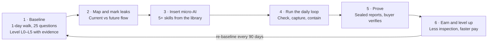
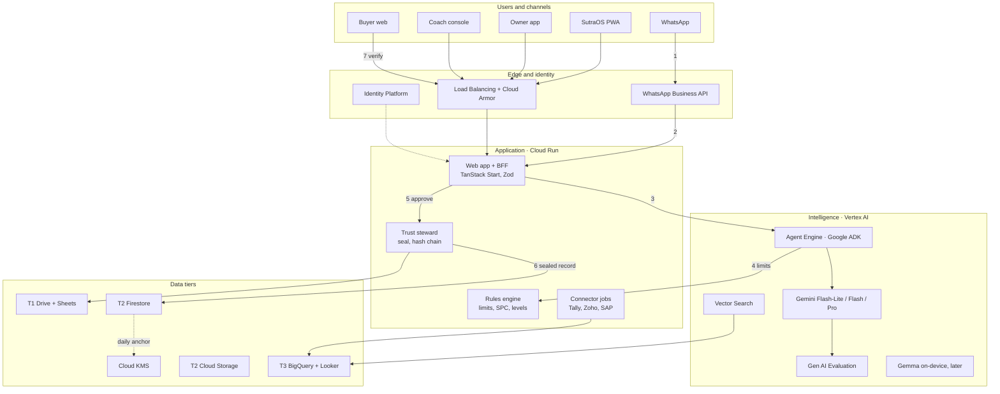

# SutraOS — Product Requirements Document (PRD) v1.0

13 Nov 2026 · Team SLB VectorSynapse · Companion to the SutraOS BRD v1.0. Supersedes GembaLeap PRD v2.0.

## 1. Overview

**SutraOS is a phone-first product that baselines a supplier plant, redesigns its flow, switches on small AI skills at the leak points, and turns daily work into a sealed, buyer-verifiable record that moves the plant up the Sutra Maturity Ladder (L0–L5).**

**Product goals (pilot)**

1. A plant's baseline and level are produced in one day with evidence.
2. Recording a check with evidence takes under 20 seconds, in the operator's language, on WhatsApp or the app.
3. Each plant switches on at least 5 micro-AI skills, each with a measured time saving or error catch.
4. A buyer verifies a sealed report in one click and grants rewards based on level.
5. 60% of pilot plants gain one level within 90 days.

**In scope:** Sutra Baseline, process mapping, daily checklist and capture, micro-AI skills, daily/weekly reports, CAPA/8D, lot passport and MTC check, consent-scoped sharing, buyer verification, maturity ladder, payment clock, audit packs for ZED/ISO/IATF, tiered storage on Google tools.

**Non-goals:** replacing ERP, MES or accounting; machine sensors or IoT gateways (optional later); lending money; public supplier rankings; a marketplace taking a cut of orders.

**Carried over from GembaLeap:** daily checklist (F16), sealed reports (F17), ask-the-evidence (F18), maturity audit (F2), bottleneck ranking (F3), NCR/8D room (F4), lot passport (F5), consent sharing (F6), heat-map (F9), payment clock (F11), earned inspection (F15), sourcing pool (F19).

## 2. Personas and jobs-to-be-done

| Role                | Persona                                     | Side     | Job to be done                                                     | Primary surface                                |
| ------------------- | ------------------------------------------- | -------- | ------------------------------------------------------------------ | ---------------------------------------------- |
| `operator`          | Ravi, CNC operator, Marathi                 | Supplier | "Log my check fast so I can get back to the machine."              | WhatsApp bot or app Today tab                  |
| `line_lead`         | Lan / Sunita, line lead                     | Supplier | "Know what went wrong this shift and hand over cleanly."           | Checklist, Capture, Shift brief                |
| `supplier_owner`    | Suresh, 45-person fabrication plant, Chakan | Supplier | "Prove my plant is good so I get paid on time and win new buyers." | Home, Level, Reports, Sharing                  |
| `supplier_quality`  | Meena, QE                                   | Supplier | "Close problems with evidence and be audit-ready any day."         | CAPA/8D, Passports, Audit packs                |
| `buyer_quality`     | Arjun, SQE with 140 suppliers               | Buyer    | "Inspect less, catch drift early, trust evidence."                 | Supplier watch-list, Verify, Rooms             |
| `buyer_procurement` | Priya, category manager                     | Buyer    | "Find capable new vendors and show fair dealing."                  | Sourcing pool, Payment clock                   |
| `sutra_coach`       | Amol, diploma engineer                      | SutraOS  | "Baseline a plant in a day and coach 15 plants a month."           | Coach console, Baseline wizard, Process mapper |

**Key user stories**

- As an operator, I photograph the gauge and SutraOS reads the value, compares it with limits, and asks for containment if it is out of limit.
- As a supplier owner, I see my level, the one gap blocking the next level, and what the next level earns me.
- As a coach, I walk the line with my phone and get a draft current-state process map with leak points marked.
- As a buyer SQE, I open a sealed weekly report, verify the seal in my browser, and grant reduced inspection to an L3 supplier.
- As a supplier QE, I export a ZED or ISO audit pack with every clause linked to evidence.

## 3. The Sutra Method

**The product is a method first: baseline, redesign, add small AI, run, prove, earn.**



Steps 1–3 are run by a Sutra Coach in the first two weeks; steps 4–6 run every shift and every week without the coach. The reward in step 6 is what keeps step 4 alive.

## 4. Re-imagined plant flow

**A typical engineering supplier day has seven leak points; SutraOS puts one small AI skill at each and leaves one piece of evidence behind.**

| Shop-floor step      | Leak today                  | Micro-AI inserted                                    | Evidence created                                 |
| -------------------- | --------------------------- | ---------------------------------------------------- | ------------------------------------------------ |
| Material receipt     | MTC filed, never checked    | MTC checker: reads MTC; code checks the grade        | Lot passport, heat no. linked to the lot         |
| Set-up and first-off | First piece judged by eye   | Drawing to check plan: drafts control plan for coach | First-off record: photo + readings vs plan       |
| In-process checks    | Written up at shift end     | Gauge reader: photo to value; code applies limits    | Check with evidence; containment if out of limit |
| Problems on the line | Told verbally, then lost    | Voice to event: Marathi/Hindi note to defect code    | Event with original voice; one-tap confirm       |
| Shift handover       | Know-how leaves with people | Shift brief: five lines in the team's language       | Acknowledged brief, loss Pareto                  |
| Final inspection     | Buyer re-inspects 100%      | Report drafter: daily report, every claim cited      | Sealed report, buyer verifies in one click       |
| Invoice and payment  | Disputes, 73-day cash cycle | Invoice matcher: PO, GRN and invoice                 | Payment clock vs 45-day MSMED limit              |

## 5. Feature set by module

S IDs are new; F IDs carry over from GembaLeap.

| ID  | Feature                                                                                                                      | Module        | Priority     | Acceptance criterion                                                     |
| --- | ---------------------------------------------------------------------------------------------------------------------------- | ------------- | ------------ | ------------------------------------------------------------------------ |
| S1  | **Sutra Baseline wizard**: 25 questions, guided gemba walk (photos, video, voice), 2-week record upload; scores 5 dimensions | Sutra Lens    | Must         | ≥ 1 evidence item per dimension; second assessor within 1 level on ≥ 90% |
| S2  | **Process mapper**: AI drafts current-state flow from walk media; coach edits; future state with leak points                 | Sutra Lens    | Must         | Stages, owners, checks and ≥ 5 leak points                               |
| S3  | **Recipe picker**: suggests skills and check templates from the Process Library per leak point                               | Sutra Lens    | Must         | ≥ 5 skills on per plant                                                  |
| F16 | Daily checklist: evidence mandatory, limits server-side, containment enforced                                                | Daily Loop    | Must         | Cannot save without evidence; out-of-limit blocks without containment    |
| F1  | Multimodal capture → structured event, 6 languages, offline queue                                                            | Daily Loop    | Must         | One-tap confirm; original language kept                                  |
| S4  | **WhatsApp channel**: check, capture, nudges and shift brief for L0–L1 plants                                                | Daily Loop    | Must         | Same record as app; no install                                           |
| F10 | Shift handover brief with loss Pareto                                                                                        | Daily Loop    | Should       | Acknowledged at handover                                                 |
| F17 | Daily and weekly reports: AI-drafted, human-approved, hash-sealed                                                            | Trust Ledger  | Must         | 100% of claims cite evidence                                             |
| F6  | Consent-scoped sharing, revocation, access log                                                                               | Trust Ledger  | Must         | Revocation removes access at once                                        |
| F5  | Lot passport + **MTC checker**                                                                                               | Trust Ledger  | Must         | Seeded-error recall 12/12                                                |
| S5  | **Maturity ladder view**: level, blocking gap, next-level rewards                                                            | Level Up      | Must         | Gap is a specific evidence requirement                                   |
| F15 | Earned inspection tier: record suggests, buyer decides                                                                       | Level Up      | Must         | Decision logged with named approver                                      |
| S6  | **Audit pack builder**: clause-to-evidence map for ZED, ISO 9001, IATF 16949                                                 | Level Up      | Should       | Every clause shows evidence or an explicit gap                           |
| F4  | CAPA/8D room; closes only on new evidence                                                                                    | Improve       | Must         | D2–D7 need evidence                                                      |
| F3  | Bottleneck ranking (deterministic formula)                                                                                   | Improve       | Should       | Formula shown to users                                                   |
| S7  | **SPC and drift alerts**: rules in code, AI explains                                                                         | Improve       | Should       | Rule fires in code; text cites points                                    |
| F11 | Payment clock vs 45-day limit, both sides                                                                                    | Cash & Market | Must         | Days shown per invoice                                                   |
| S8  | **TReDS / lender referral** with consent                                                                                     | Cash & Market | Could        | Consent logged                                                           |
| F19 | Evidence profile + sourcing pool (opt-in)                                                                                    | Cash & Market | Should       | No public score                                                          |
| S9  | **Scheme finder**                                                                                                            | Cash & Market | Could        | Eligibility reasons shown                                                |
| F9  | Buyer watch-list and heat-map                                                                                                | Buyer         | Must         | Filters in URL                                                           |
| F18 | Ask the evidence (Q&A with citations)                                                                                        | Buyer         | Should       | Answers cite records                                                     |
| S10 | **Connectors**: Tally, Zoho Books, SAP B1/S4 read-only                                                                       | Platform      | Should (L3+) | Nightly sync, no write-back                                              |

## 6. Micro-AI skill catalog

**Each skill does one small job, has one metric, and can be switched off without breaking the flow.**

| Skill                    | Input → output                             | Leak it closes               | Model tier    | Metric                      | Unlocks |
| ------------------------ | ------------------------------------------ | ---------------------------- | ------------- | --------------------------- | ------- |
| Gauge/meter reader       | Photo → number + unit                      | Transcription errors         | Flash-Lite    | Accuracy ≥ 98%              | L1      |
| Paper sheet digitiser    | Photo of check sheet → structured rows     | Paper never reaches a system | Flash         | Field accuracy ≥ 95%        | L1      |
| Voice-to-event           | Voice note (mr/hi/ta/gu/kn) → defect event | Problems never recorded      | Flash         | Code accuracy ≥ 85%         | L1      |
| Drawing/PO to check plan | Drawing + PO → draft control plan          | No standard plan             | Pro           | Coach accepts ≥ 80% of rows | L2      |
| MTC checker              | MTC → chemistry/mechanicals vs spec        | Wrong material shipped       | Flash + rules | 12/12 seeded errors         | L2      |
| Report drafter           | Day's records → cited report               | No proof for buyer           | Flash         | 100% claims cited           | L2      |
| Shift brief              | Last shift → 5-line brief                  | Lost handover                | Flash-Lite    | Acknowledged ≥ 90%          | L2      |
| Drift explainer          | SPC rule fired → plain note                | Late drift detection         | Flash-Lite    | Alert to action < 4 h       | L3      |
| CAPA/8D drafter          | NCR + evidence → 8D draft                  | Weak root cause              | Pro           | Rubric ≥ 4/5                | L3      |
| Audit pack mapper        | Records → clause map                       | Weeks of audit prep          | Flash         | 0 invented evidence         | L3      |
| Invoice/PO matcher       | Invoice, PO, GRN → match                   | Payment disputes             | Flash-Lite    | Precision ≥ 97%             | L3      |
| Ask the evidence         | Question → cited answer                    | Email back-and-forth         | Flash         | Citations valid 100%        | L3      |
| Scheme finder            | Plant profile → eligible schemes           | Unclaimed support            | Flash + rules | Reasons shown               | Any     |

**Escalation rule (in code):** start on Flash-Lite; move to Flash when confidence < threshold or input is long; Pro only for control plans and 8D. Every call logs model, cost and latency.

## 7. Tiered storage and connectivity model

**Storage follows the plant.** One logical record model (Zod schema) is written to whichever Google store fits the plant's scale, connectivity and data type.

| Tier             | Plant profile                        | Capture surface                      | System of record                        | Files and media                    | Analytics             | Connectivity                                       |
| ---------------- | ------------------------------------ | ------------------------------------ | --------------------------------------- | ---------------------------------- | --------------------- | -------------------------------------------------- |
| **T1 Lite**      | Micro, L0–L1, < 25 people, patchy 4G | WhatsApp bot, Google Forms, AppSheet | Google Sheets in supplier's own account | Supplier-owned Google Drive        | Looker Studio         | WhatsApp queues offline                            |
| **T2 Core**      | Small, L1–L3, 25–250 people          | SutraOS PWA + WhatsApp               | Firestore (per tenant)                  | Cloud Storage, signed URLs         | Daily BigQuery export | PWA offline queue; last-confirmed wins, audit kept |
| **T3 Connected** | Medium, L3–L5, has ERP               | PWA + connectors                     | Firestore + ERP master for POs/items    | Cloud Storage with retention, CMEK | BigQuery + Looker     | Pub/Sub; nightly ERP sync                          |

- **Data type decides the store:** structured records → Sheets (T1) or Firestore (T2+); photos, PDFs, MTCs → Drive (T1) or Cloud Storage (T2+); history → BigQuery.
- **Seals are tier-independent:** SHA-256 over canonical JSON, chained in an append-only log; daily anchor signed with Cloud KMS.
- **Ownership:** T1 data stays in the supplier's Drive; T2/T3 support full export.
- **Promotion:** one-click migration from T1 to T2 re-verifies every seal.
- **Residency:** `asia-south1` (Mumbai), backups `asia-south2` (Delhi).

## 8. Solution architecture on Google Cloud

**Five layers on managed Google services; the only custom infrastructure is the rules and trust code.** Numbers trace one check end to end.



Platform services: Pub/Sub, Cloud Scheduler, Cloud Run jobs (daily report, shift brief, level recompute, log anchor), Secret Manager, Cloud Logging and Monitoring, Terraform + GitHub Actions. Partners: WhatsApp Business API, TReDS and lender APIs. Contracts flow Zod → JSON Schema → Pydantic.

## 9. Agents, models and deterministic rules

**Agents are small and single-purpose, built with Google ADK on Vertex AI; anything that decides pass/fail, rank or seal is plain code.** Model IDs come from config, pinned to the latest stable Gemini release at deploy time.

| Agent         | Skills it runs                                | Default tier       | Tools it may call                            |
| ------------- | --------------------------------------------- | ------------------ | -------------------------------------------- |
| Capture       | Gauge reader, sheet digitiser, voice-to-event | Flash-Lite → Flash | Schema validator, limits service             |
| Baseline      | Walk media → draft scores and process map     | Pro                | Process Library, maturity rules              |
| Planner       | Drawing/PO → control plan; recipe picker      | Pro                | Process Library, clause index                |
| Report        | Daily/weekly report, shift brief              | Flash              | Evidence store (read-only), citation checker |
| Quality       | Drift explainer, CAPA/8D                      | Flash / Pro        | SPC service, evidence store                  |
| Passport      | MTC and lot documents                         | Flash              | Grade spec tables, rule engine               |
| Cash          | Invoice matcher, payment clock, scheme finder | Flash-Lite         | Payment and scheme rules                     |
| Ask           | Q&A over consented evidence                   | Flash              | Vector Search, consent filter                |
| Orchestrator  | Routes WhatsApp and app messages              | Flash-Lite         | All of the above                             |
| Trust steward | Seals, audit chain, consent checks            | None (code)        | KMS, audit log                               |

**Google AI tooling**

| Tool               | Use                                                                    |
| ------------------ | ---------------------------------------------------------------------- |
| Google AI Studio   | Prompt design and prototyping of each micro-skill on real plant photos |
| Google Antigravity | Agent-first IDE to build the TypeScript app and Python agents          |
| Agent Skills (ADK) | Each micro-skill packaged with instructions, tools and eval set        |
| Vertex AI          | Gemini inference, Agent Engine, Vector Search, Evaluation              |
| Gemma (later)      | Offline gauge reading and translation on low-connectivity phones       |

**Deterministic rules (code, not prompts)**

```
stage_level = min over dimensions of level_d   (each backed by >= 1 evidence item)
plant_level = min over critical stages of stage_level_s
priority    = loss_30 x |lambda| x (1 + recurrence) / effort
seal        = sha256(canonicalJSON(report))
audit hash  = sha256(prev_hash || canonicalJSON(entry))
```

Level promotion also needs an evidence streak: L2 needs 30 days; L3 needs 90 days with ≥ 95% check adherence and a buyer verification.

## 10. Non-functional requirements

| Area          | Requirement                                                                                  |
| ------------- | -------------------------------------------------------------------------------------------- |
| Speed         | Check recorded in < 20 s; first load < 3 s on 3G; AI reading < 4 s (p90)                     |
| Offline       | Capture and checklist fully offline; queue survives restart; sync within 60 s                |
| Devices       | Android 9+, 3 GB RAM; desktop for owners and buyers; no hardware                             |
| Languages     | Marathi, Hindi, Tamil, Gujarati, Kannada, English at launch; Telugu, Bengali in Wave 2       |
| Accessibility | WCAG 2.2 AA; icon + colour + text for status; large tap targets                              |
| Availability  | 99.5% monthly for T2/T3                                                                      |
| Security      | Per-tenant isolation, least privilege, CMEK for T3, 15-min signed URLs, phone OTP, buyer SSO |
| Privacy       | DPDP Act 2023 consent and deletion; faces blurred in shared photos                           |
| Cost          | AI + cloud ≤ ₹1,000 per T2 plant per month at 300 checks/day                                 |
| Auditability  | Every AI call, approval, share and view in the hash-chained log                              |
| Residency     | `asia-south1`, backups `asia-south2`                                                         |

## 11. Responsible AI, data governance and trust

1. **Human approval.** A named person approves every report, 8D, level change and share another party sees. Drafts are visibly marked.
2. **Code decides.** Limits, SPC rules, levels, rankings, MTC pass/fail and seals are computed in code.
3. **Every claim cites evidence.** A citation checker blocks publication if any sentence lacks a valid link.
4. **Supplier owns its data.** Sharing is scoped, revocable at once, and every view is logged.
5. **No public ranking.** Benchmarks need ≥ 5 plants per cell.
6. **Anti-gaming.** Metadata and duplicate checks, random re-capture, buyer spot audits.
7. **Fair use of the record.** A buyer cannot use a supplier's record in price talks without the supplier seeing the same analysis.
8. **Language fidelity.** Original voice and text are always kept beside the translation.

## 12. Evals and acceptance criteria

| Eval                  | Golden set                | Pass bar                    | State                   |
| --------------------- | ------------------------- | --------------------------- | ----------------------- |
| Gauge reader          | 500 photos, 6 gauge types | ≥ 98% within tolerance      | To build                |
| Sheet digitiser       | 200 real check sheets     | ≥ 95% field accuracy        | To build                |
| Voice-to-event codes  | 60 events, 5 languages    | ≥ 85%                       | Needs golden set        |
| Translation fidelity  | 30 vi/hi/mr notes         | 0 safety-relevant losses    | Needs golden set        |
| Baseline agreement    | 10 plants, 2 assessors    | Within 1 level on ≥ 90%     | To build                |
| Control plan draft    | 20 drawings               | Coach accepts ≥ 80% of rows | To build                |
| MTC / passport recall | 40 lots, 12 seeded errors | 12/12, < 10% false warnings | **Passing (GembaLeap)** |
| Report citations      | 30 reports                | 100% valid                  | Needs golden set        |
| 8D quality            | 10 NCRs, rubric           | Mean ≥ 4/5                  | Needs golden set        |

**End-to-end acceptance (MVP):** operator records a check by WhatsApp photo; out-of-limit forces containment; owner approves a sealed weekly report; buyer verifies the seal; level view shows L2 with the next gap; consent revoked removes access at once. The GembaLeap suite already passes 9 end-to-end tests on synthetic data.

## 13. Release plan, MVP scope and open questions

| Release           | Window              | Scope                                                                            | Exit criterion                                 |
| ----------------- | ------------------- | -------------------------------------------------------------------------------- | ---------------------------------------------- |
| R0 Buildathon MVP | Nov 2026 – Jan 2027 | S1, S2 (coach-assisted), F16, F1, S4, F17, F6, F5 + MTC, S5, F9; T1 + T2 storage | Full loop demo on 2 real plants                |
| R1 Pilot          | Feb – Jul 2027      | + F15, F4, F11, S6, offline PWA, 6 languages, Identity Platform, KMS anchor      | 60% of plants level up; inspection −30%        |
| R2 Cluster        | Aug 2027 – Jun 2028 | + S7, S10, S8, F19, coach console v2                                             | 1,000 paying plants; GM ≥ 65%                  |
| R3 Network        | Jul 2028 +          | Multi-buyer records, partner API, data-space bridge, Gemma offline               | Second buyer accepts a record without re-audit |

**Open questions**

- [ ] Which anchor buyer signs first, and which single reward does it commit to?
- [ ] Can SutraOS be empanelled for ZED handholding, or should we partner with an empanelled consultant?
- [ ] WhatsApp Business API provider and per-message cost at 300 checks per plant per day?
- [ ] Do T1 plants accept a Google account per plant, or do we provision one?
- [ ] Which lender or TReDS platform will accept a verified operating summary as a credit signal?
